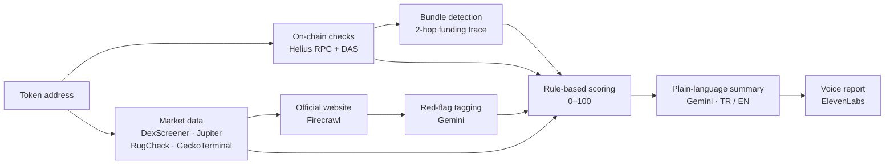
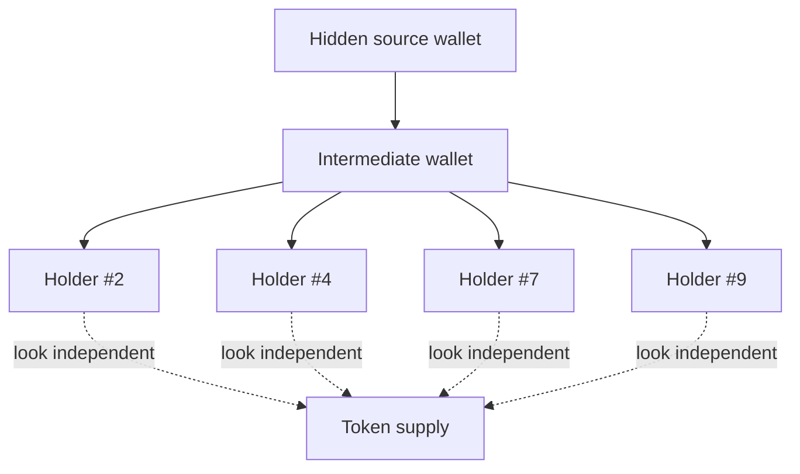
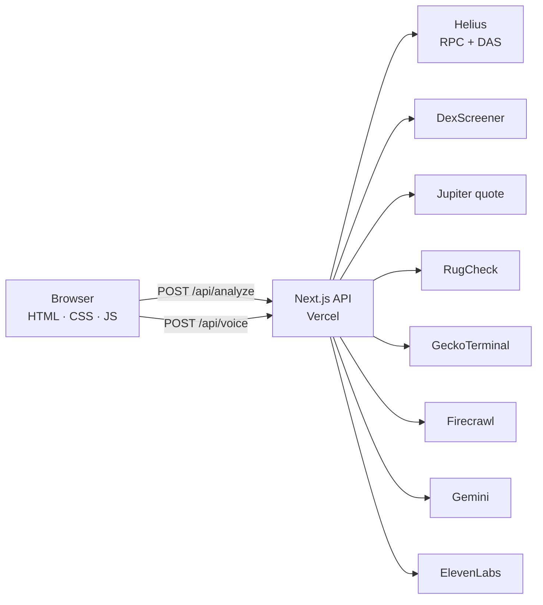

<p align="center">
  
</p>

<h1 align="center">SolExpert: An Inspection Report for Solana Tokens</h1>

<p align="center">
  <b>An AI agent that inspects a Solana token before you buy it, and tells you what it found in plain language.</b>
</p>

<p align="center">
  Paste a token address. SolExpert reads the token straight from the Solana blockchain, traces who really holds the supply, tests whether you can actually sell, checks the project's website,<br/>
  and returns a 0–100 risk score with a report you can read or listen to, in Turkish or English.
</p>

<p align="center">
  <a href="https://solexpert-rho.vercel.app"><b>🔗 Live demo: solexpert-rho.vercel.app</b></a>
</p>

<p align="center">
  <a href="#how-an-analysis-works">How It Works</a> ·
  <a href="#the-11-checks">The 11 Checks</a> ·
  <a href="#bundle-detection">Bundle Detection</a> ·
  <a href="#architecture">Architecture</a> ·
  <a href="#run-locally">Run Locally</a>
</p>

<p align="center">
  
  
  
  
  
  
  
  
</p>

---

## The problem

Anyone can launch a Solana token in a few clicks. Exchanges review a token for months before listing it, but people buy new tokens in their **first hours**, straight from the chain, when nobody has reviewed anything. That window is where rug pulls, honeypots and pump-and-dumps happen.

| Friction | What it causes |
| --- | --- |
| **The warning signs live on-chain** | Mint authority, freeze authority, Token-2022 extensions and holder concentration are public, but reading them requires knowledge most buyers don't have. |
| **Scams are designed to pass simple checks** | Authorities get revoked and liquidity gets locked, while the supply is quietly split across hundreds of wallets controlled by the same people. |
| **A number without a reason** | Score-only checkers say "72/100" but not *why*, so users can't judge the risk themselves. |
| **Website claims go unverified** | A site can say "liquidity locked" or "guaranteed 100x" while the chain says otherwise. Nobody cross-checks. |

**The problem is not small:**

| | |
| --- | --- |
| **76,469** | Solana tokens flagged as rug pull candidates out of 100,063 new tokens (Jan–Jun 2025). Candidates, not confirmed findings. |
| **$151M+** | Direct losses, cashed out by 7,322 profitable addresses; unrealised drops excluded. |
| **461** | Freeze traps: tokens that froze buyers' ability to sell. |
| **98.6%** | Share of 7M+ Pump.fun tokens whose liquidity fell below $1,000. |

<sub>Sources: Chen et al., <a href="https://arxiv.org/abs/2603.24625">SolRugDetector</a>, arXiv:2603.24625 (2026) · Solidus Labs (2025) · <a href="https://deepstrike.io/blog/rug-pull-statistics">DeepStrike, Rug Pull Statistics 2026</a></sub>

---

## The SolExpert solution

SolExpert works like a used-car inspection for tokens. It doesn't ask what people are *saying* about a token; it **examines the token itself**.

- **Reads the chain live.** Who can mint new tokens? Who can freeze your wallet? Are there hidden Token-2022 settings? All answered from Solana in seconds.
- **Follows the money.** Traces the largest holders two funding hops back to expose wallets that look independent but share the same source.
- **Tests the exit.** Asks Jupiter for a real sell quote. If no route exists, you may be looking at a honeypot.
- **Cross-checks the website.** Reads the official site and flags claims that contradict on-chain facts.
- **Explains, then speaks.** Turns findings into a short report in Turkish or English and reads it aloud.

> **A general-purpose AI reads what people say about a token. SolExpert inspects the token itself.**

### Typical token checker vs. SolExpert

| | Typical score-only checker | SolExpert |
| --- | --- | --- |
| **Output** | A number | A number, a verdict, a plain-language reason for every finding, and a voice report |
| **Holder analysis** | Top-holder percentage | Top holders **plus** two-hop funding trace to detect linked wallets |
| **Liquidity pools** | Often counted as "whales" | Detected and labeled as pools, so they don't distort the picture |
| **Website** | Not checked | Scraped and cross-checked against on-chain facts |
| **Missing data** | Often silently treated as "fine" | Reported as **unknown**, and raises the risk level when it matters |
| **Language** | English | Turkish and English |

---

## How an analysis works

### 01 · Read the chain
SolExpert fetches the token's mint account and metadata from Solana: mint and freeze authority, Token-2022 extensions, supply, name, and the official links the creator stored on-chain.

### 02 · Follow the holders
It reads the largest token accounts, separates liquidity pools and program accounts from real wallets, finds the creator's wallet, and traces where the top holders got their funds.

### 03 · Test the market
It checks liquidity and pool age on DexScreener, liquidity locks on RugCheck, price history on GeckoTerminal, and asks Jupiter for a real sell quote.

### 04 · Read the website
Firecrawl scrapes the official site. Gemini tags three fixed red flags: template content, unrealistic promises, and claims that contradict the chain.

### 05 · Score with fixed rules
Every finding becomes a check result. Transparent rules turn those results into a 0–100 score. The same token always gets the same score.

### 06 · Explain and speak
Gemini writes a short summary **from the findings only**. ElevenLabs reads it aloud.



---

## The 11 checks

| Group | Check | What it catches | Max points |
| --- | --- | --- | --- |
| **Who holds the keys?** | Mint authority | The creator can print unlimited new tokens | 25 |
| | Freeze authority | The creator can freeze your tokens so you can't sell | 15 |
| | Hidden settings (Token-2022) | Transfer taxes, permanent delegates, transfer hooks | 20 |
| **Who holds the supply?** | Top 10 holders | Supply concentrated in a few wallets (pools excluded) | 15 |
| | Creator share | The creator still holds a large share | 10 |
| | Linked wallets | "Independent" holders funded from the same source | 20 |
| **Can you actually trade?** | Sell test | Honeypots: tokens you can buy but can't sell | 30 |
| | Liquidity | Pools so shallow that one sale crashes the price | 20 |
| | Liquidity lock | The developer can pull the pool and run | 15 |
| **Is the project real?** | Token age | Brand-new tokens, the riskiest window | 5 |
| | Official website | Unrealistic promises, or claims that contradict the chain | 10 |

---

## Bundle detection

A common rug-pull setup: the team revokes the authorities, locks the liquidity, then splits the supply across hundreds of fresh wallets. Every classic check passes and the top-10 share looks healthy.

SolExpert looks at **who funded the largest holders**:

1. Take the 12 largest token accounts and resolve their owners. Pools and program accounts are excluded.
2. **Hop 1:** find who sent SOL to each wallet in its first transaction.
3. **Hop 2:** find who funded *that* wallet.
4. Group wallets that share a source. Exchange-like sources (1000+ transactions) only link wallets created within an hour of each other, to avoid false alarms.



**Case study: Commonwealth (CWU), a documented rug pull.**

| Analysis | Score | Verdict |
| --- | --- | --- |
| Classic checks only (authorities, liquidity, top 10, website) | **0 / 100** | Looks clean |
| With linked-wallet detection | **61 / 100** | 🔴 Stay away |

---

## Scoring model

### The AI explains; it doesn't decide

The risk score is **never produced by the language model.** It comes from fixed, readable rules in [`lib/scoring/score.ts`](lib/scoring/score.ts). The model only tags three yes/no website flags (worth at most 10 points) and writes the summary from the findings.

| Score | Verdict | Meaning |
| --- | --- | --- |
| 0–30 | 🟢 **Looks clean** | No notable risk in the basic checks. Not a guarantee. |
| 31–60 | 🟡 **Be careful** | Some warning signs, or important data couldn't be retrieved |
| 61–100 | 🔴 **Stay away** | Serious red flags |

### Rules that look at the whole picture

| Situation | Effect |
| --- | --- |
| Linked wallets detected | Score raised to at least **61** |
| 3 or more dangerous checks | Score raised to at least **61** |
| 2 dangerous checks | Score raised to at least **31** |
| Younger than 24 hours **and** liquidity under $10,000 | Score raised to at least **61** |
| Sell test, liquidity or top 10 couldn't be checked | Score raised to at least **31**, with the reason shown. Established tokens are exempt (authorities revoked, liquidity over $1M, older than 90 days) |

### Guardrails on the AI summary

- Never calls a token "safe" in either language. Passing the checks is not a guarantee.
- When there are dangerous findings, the risks come first.
- Uses the exact check names from the findings; no paraphrasing that could change the meaning.
- Temperature 0, with an automatic fallback model when the main model is busy.

---

## Product surface

| Component | What it does |
| --- | --- |
| **Scan bar and demo buttons** | Paste any address, or try a sample clean (BONK) or sample risky (CWU) token in one click |
| **Live progress steps** | Shows each stage as it runs: reading the chain, checking authorities, analysing wallets, reading the website, writing the report |
| **Risk gauge and verdict** | 0–100 gauge with a clear headline: *Looks clean*, *Be careful*, *Stay away* |
| **AI summary** | A three-sentence explanation of the most important findings |
| **Listen to the report** | ElevenLabs reads the summary aloud |
| **Copy link** | Shareable link (`?address=...`) that starts the analysis automatically |
| **Five check cards** | The 11 checks grouped into five questions, each with a *Technical detail* toggle |
| **Peak cards** | Change from peak price (7 days), liquidity in pool, share held by the top 10 wallets |
| **Who holds the supply?** | Holder distribution chart, with liquidity pools labeled separately |
| **Found on the website** | Red flags and observations from the official site |
| **Ekspi, the owl** | Mascot assistant with sourced "Did you know?" facts, a quick-scan panel and voice settings (voice, speed, pitch) |
| **TR / EN** | Full Turkish and English interface and reports |

---

## Why Solana

| Solana characteristic | Why it matters for SolExpert |
| --- | --- |
| **One-click token launchpads** | Thousands of tokens launch daily, so automated inspection is the only scalable answer |
| **Authorities live on the mint** | Mint and freeze authority can be read in a single account query |
| **Token-2022 extensions** | Powerful features (transfer fees, permanent delegates, hooks) that need explicit checks |
| **Rich RPC and DAS APIs** | Metadata, holders and transaction history are available without running our own indexer |
| **Jupiter aggregator** | A real sell quote across all major DEXs, giving a practical honeypot test |

---

## Architecture



### What runs on the server
- Parallel on-chain and market checks with per-check timeouts: one failing source never breaks the report
- Two-hop bundle tracing with concurrency limits and automatic retries
- Two Helius keys with automatic failover when one is rate-limited
- Rule-based scoring and the AI summary
- A 10-minute report cache; identical concurrent requests share one analysis
- Text-to-speech proxy, so API keys never reach the browser

### What runs in the browser
- The scan flow, progress steps, gauge and cards
- Holder distribution and peak charts
- Ekspi the owl, voice settings, language switch and share links

---

## Try it

| Token | Address | Expected |
| --- | --- | --- |
| BONK | `DezXAZ8z7PnrnRJjz3wXBoRgixCa6xjnB7YaB1pPB263` | 🟢 Looks clean |
| Jupiter (JUP) | `JUPyiwrYJFskUPiHa7hkeR8VUtAeFoSYbKedZNsDvCN` | 🟢 Looks clean |
| Wrapped SOL | `So11111111111111111111111111111111111111112` | 🟢 Looks clean |
| Commonwealth (CWU), a documented rug pull | `CmVUoJUt7hMGc9ze7s8zYdnA7enMfCAFdQCggxcbACWU` | 🔴 Stay away (linked wallets) |
| PayPal USD (PYUSD) | `2b1kV6DkPAnxd5ixfnxCpjxmKwqjjaYmCZfHsFu24GXo` | 🔴 The issuer can mint, freeze and move tokens. Legitimate for a regulated stablecoin, a red flag for a memecoin |

For the freshest risky examples, pick a token that is a few hours old with under $10,000 liquidity from [DexScreener new pairs](https://dexscreener.com/new-pairs/solana).

---

## Run locally

> **No setup needed to try it:** the app is live at **[solexpert-rho.vercel.app](https://solexpert-rho.vercel.app)**. The steps below are for running your own copy.

### Requirements
- Node.js 20 or newer
- Free API keys: [Helius](https://helius.dev), [Google AI Studio](https://aistudio.google.com) (Gemini), [Firecrawl](https://firecrawl.dev), [ElevenLabs](https://elevenlabs.io)

### Quick start

```bash
git clone https://github.com/ozgurmermertas/SOLEXPERT.git
cd SOLEXPERT
npm install
cp .env.example .env.local   # then fill in your keys
npm run dev
```

Your local copy runs at `http://localhost:3000`.

### Useful commands

```bash
npm run dev                                # development server
npm run typecheck                          # type check
npm run test:token -- <ADDRESS>            # analyze one token in the terminal
npm run test:token -- <ADDRESS> --no-ai    # on-chain checks only (fast)
```

### Deploy your own

Import the repository on [Vercel](https://vercel.com), add the environment variables below, and deploy. Every push to `main` redeploys automatically.

---

## Configuration

| Variable | Required | Purpose |
| --- | --- | --- |
| `HELIUS_API_KEY` | ✅ | Solana RPC and DAS |
| `HELIUS_API_KEY_2` | | Second key, used automatically when the first is rate-limited |
| `GOOGLE_GENERATIVE_AI_API_KEY` | ✅ | Website analysis and summaries |
| `GEMINI_MODEL` | | Defaults to `gemini-flash-latest`; falls back to a lighter model when busy |
| `FIRECRAWL_API_KEY` | | Website analysis (skipped if missing) |
| `ELEVENLABS_API_KEY` | | Voice report |
| `ELEVENLABS_VOICE_ID` | | Default voice |

`.env.local` is git-ignored, and keys are only used on the server. Never commit real keys.

---

## API

| Endpoint | Body / query | Returns |
| --- | --- | --- |
| `POST /api/analyze` | `{ "address": "...", "lang": "tr" \| "en", "withAi": true }` | `TokenReport` (see [`lib/types.ts`](lib/types.ts)) |
| `GET /api/analyze` | `?address=...&ai=0` | Same; handy for testing in the browser |
| `POST /api/voice` | `{ "text": "..." }` | `audio/mpeg` |

Reports are cached for 10 minutes. Full details are in [API.md](API.md).

---

## Repository map

```
app/api/
├── analyze/route.ts        Analysis endpoint
└── voice/route.ts          Text-to-speech endpoint

lib/
├── analyze.ts              Main pipeline: runs every check, scores, summarizes, caches
├── types.ts                Shared TokenReport contract between backend and frontend
├── http.ts · config.ts     Fetch helpers, Helius failover, environment
├── onchain/
│   ├── mint.ts             Mint and freeze authority, Token-2022 extensions
│   ├── metadata.ts         Name, symbol, official links from on-chain metadata
│   ├── holders.ts          Top holders, creator wallet and share
│   ├── owners.ts           Wallet vs. pool/program detection
│   ├── bundle.ts           Two-hop linked-wallet detection
│   ├── market.ts           Liquidity, pool age, links (DexScreener)
│   ├── sellTest.ts         Sell quote (Jupiter)
│   ├── lpLock.ts           Liquidity lock (pump.fun curve / RugCheck)
│   └── priceHistory.ts     7-day price history (GeckoTerminal)
├── offchain/website.ts     Website scraping and red-flag tagging
├── scoring/score.ts        Every scoring rule, in one file
└── ai/
    ├── gemini.ts           Gemini calls with retry and fallback model
    └── report.ts           Summary writing and guardrails

public/
├── index.html              The SolExpert interface
├── css/                    Styles
└── js/                     App logic, charts, i18n, Ekspi the owl, voice

scripts/test-token.ts       Command-line analysis tool
```

---

## Technology stack

| Layer | Technology |
| --- | --- |
| **Application** | Next.js 15 (App Router), TypeScript |
| **Frontend** | HTML, CSS and vanilla JavaScript; hand-built charts and an SVG mascot |
| **Solana data** | Helius RPC + DAS API, called with plain `fetch` (no SDK) |
| **Market data** | DexScreener, Jupiter quote API, RugCheck, GeckoTerminal |
| **Website analysis** | Firecrawl |
| **AI** | Google Gemini (flash, with lite fallback) |
| **Voice** | ElevenLabs multilingual text-to-speech |
| **Hosting** | Vercel |

---

## Trust model and scope

SolExpert is a hackathon MVP. Important boundaries:

- **Read-only.** SolExpert never signs transactions, never asks for a wallet, and never touches funds. The sell test is a price quote, not a trade.
- **Free-tier limits.** Helius and Gemini can be rate-limited; affected checks are shown as *unknown*, never silently as safe.
- **Bundle detection has limits.** It inspects the 12 largest holders and two funding hops. Deeper chains, cross-chain funding or wallets outside the top 12 can be missed.
- **Liquidity history** isn't available from free sources, so liquidity is shown as a current value.
- **The website check** reads only the official link stored in the token's metadata or on DexScreener, and the AI's tags are limited to three fixed yes/no flags.
- **A low score is not a guarantee**, and a high score is not proof of fraud. Some legitimate assets (such as regulated stablecoins) keep authorities on purpose.

### Roadmap
- Write a hash of each report to Solana so past verdicts can be verified
- Persistent report history and verdict accuracy tracking
- Social signal analysis: bot detection on X
- Browser extension and Solana Mobile app

---

## Team

| | Role |
| --- | --- |
| **Özgür Mermertaş** | Backend: on-chain checks, bundle detection, scoring, AI pipeline |
| **Rojin Işık** | Frontend: design, Ekspi the owl, interface |

---

## Disclaimer

SolExpert is an automated risk assessment based on on-chain data and website content. **It is not financial advice.** Always do your own research.

---

<p align="center">
  <b>Built for the Dev3pack Hackathon 2026 · Solana</b><br/>
  Paste an address. Get the inspection. Decide for yourself.
</p>
