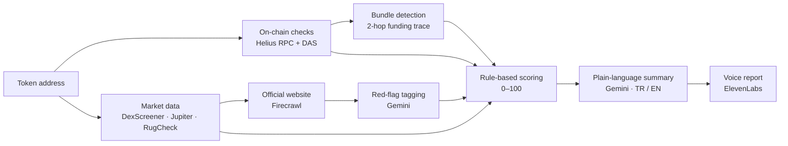

# 🦉 SolExpert

**An AI agent that inspects Solana tokens before you buy them.**

Paste a token address. SolExpert reads the token straight from the Solana blockchain, checks its official website, and returns a 0–100 risk score with a plain-language report you can read or listen to, in Turkish or English.

> Built for the **Dev3pack Hackathon** (Solana · 27–29 November 2026).

<!-- Live demo: https://YOUR-PROJECT.vercel.app -->

---

## The problem

Thousands of new tokens launch on Solana every day, most of them on one-click launchpads like pump.fun. Exchanges such as Binance review a token for months before listing it, but people buy new tokens in their first hours, straight from the chain, when nobody has reviewed anything.

That is where most rug pulls, honeypots and pump-and-dumps happen. The warning signs are on-chain, but reading them needs knowledge most buyers don't have.

## What SolExpert does

SolExpert acts like a used-car inspection for tokens. It runs **11 checks** in about 5–25 seconds and explains the result in everyday language:

| Group | Check | What it catches |
|---|---|---|
| **Who holds the keys?** | Mint authority | The creator can print unlimited new tokens |
| | Freeze authority | The creator can freeze your tokens so you can't sell |
| | Hidden settings (Token-2022) | Transfer taxes, permanent delegates, transfer hooks |
| **Who holds the supply?** | Top 10 holders | Supply concentrated in a few wallets |
| | Creator share | The creator still holds a large share |
| | **Linked wallets (bundle detection)** | Many "independent" holders funded from the same source |
| **Can you actually trade?** | Sell test | Honeypots: tokens you can buy but can't sell |
| | Liquidity | Pools so shallow that one sale crashes the price |
| | Liquidity lock | Developer can pull the pool and run (rug pull) |
| **Is the project real?** | Token age | Brand-new tokens, the riskiest window |
| | Official website | Unrealistic promises, or claims that contradict the chain |

### Why bundle detection matters

A common rug-pull trick is to spread the supply across hundreds of fresh wallets, so every classic check passes: authorities revoked, liquidity locked, top-10 share looks healthy. SolExpert traces the largest holders **two funding hops back** and groups wallets that were funded by the same source. In our tests, a documented rug pull that scored **0/100** on the classic checks alone scored **61/100 (high risk)** once linked wallets were detected.

## How it works



### Design principle: the AI explains, it doesn't decide

The **risk score is never produced by the language model.** It is calculated by fixed, transparent rules in [`lib/scoring/score.ts`](lib/scoring/score.ts), so the same token always gets the same score. The model only:

- tags three fixed red flags on the project website (template text, unrealistic promises, contradictions with on-chain facts), worth at most 10 points, and
- writes the human-readable summary from the findings.

Further safeguards:

- The summary is never allowed to call a token "safe". Passing the checks is not a guarantee.
- If a check can't be completed, it is reported as **unknown** instead of being counted as safe. Unknown critical checks raise the level to at least "caution".
- Combinations of warnings raise the score floor. For example, a token younger than 24 hours with less than $10,000 of liquidity is always "high risk".

### Scoring

| Score | Level | Meaning |
|---|---|---|
| 0–30 | 🟢 Low | No notable risk found in the basic checks (not a guarantee) |
| 31–60 | 🟡 Caution | Some warning signs |
| 61–100 | 🔴 High | Serious red flags: stay away |

The full rule table lives in [`lib/scoring/score.ts`](lib/scoring/score.ts).

## Tech stack

| Layer | Technology |
|---|---|
| App | Next.js (App Router) + TypeScript |
| Frontend | HTML, CSS and vanilla JavaScript (`public/`) |
| Solana data | Helius RPC + DAS API (plain `fetch`, no SDK) |
| Market data | DexScreener, Jupiter quote API, RugCheck, GeckoTerminal |
| Website analysis | Firecrawl |
| AI | Google Gemini |
| Voice | ElevenLabs (multilingual) |
| Hosting | Vercel |

## Getting started

### Requirements

- Node.js 20 or newer
- Free API keys: [Helius](https://helius.dev), [Google AI Studio](https://aistudio.google.com) (Gemini), [Firecrawl](https://firecrawl.dev), [ElevenLabs](https://elevenlabs.io)

### Setup

```bash
git clone https://github.com/ozgurmermertas/SOLEXPERT.git
cd SOLEXPERT
npm install
cp .env.example .env.local   # then fill in your keys
npm run dev
```

Open http://localhost:3000.

### Environment variables

| Variable | Required | Description |
|---|---|---|
| `HELIUS_API_KEY` | ✅ | Solana RPC and DAS |
| `HELIUS_API_KEY_2` | | Optional second key; used automatically when the first is rate-limited |
| `GOOGLE_GENERATIVE_AI_API_KEY` | ✅ | Website analysis and summaries |
| `GEMINI_MODEL` | | Defaults to `gemini-flash-latest`; falls back to a lighter model when busy |
| `FIRECRAWL_API_KEY` | | Website analysis (skipped if missing) |
| `ELEVENLABS_API_KEY` | | Voice report |
| `ELEVENLABS_VOICE_ID` | | Default voice |

`.env.local` is git-ignored. Never commit real keys.

### Useful commands

```bash
npm run dev                         # development server
npm run typecheck                   # type check
npm run test:token -- <ADDRESS>     # analyze one token in the terminal
npm run test:token -- <ADDRESS> --no-ai   # on-chain checks only (fast)
```

## API

| Endpoint | Body | Returns |
|---|---|---|
| `POST /api/analyze` | `{ "address": "...", "lang": "tr" \| "en" }` | `TokenReport` (see [`lib/types.ts`](lib/types.ts)) |
| `GET /api/analyze?address=...` | | Same, handy for testing in the browser |
| `POST /api/voice` | `{ "text": "..." }` | `audio/mpeg` |

Results are cached for 10 minutes. Full details are in [API.md](API.md).

## Project structure

```
app/api/analyze     → analysis endpoint
app/api/voice       → text-to-speech endpoint
lib/analyze.ts      → main pipeline: runs every check, scores, summarizes
lib/onchain/        → mint, metadata, holders, bundle, market, sell test, LP lock, price history
lib/offchain/       → official website analysis
lib/scoring/        → all scoring rules
lib/ai/             → Gemini calls and summary writing
public/             → frontend (HTML, CSS, JS, mascot, i18n)
scripts/            → command-line test tool
```

## Try it

| Token | Address | Expected |
|---|---|---|
| BONK | `DezXAZ8z7PnrnRJjz3wXBoRgixCa6xjnB7YaB1pPB263` | 🟢 Low |
| Jupiter (JUP) | `JUPyiwrYJFskUPiHa7hkeR8VUtAeFoSYbKedZNsDvCN` | 🟢 Low |
| Commonwealth (CWU), a documented rug pull | `CmVUoJUt7hMGc9ze7s8zYdnA7enMfCAFdQCggxcbACWU` | 🔴 High (linked wallets) |
| PayPal USD (PYUSD) | `2b1kV6DkPAnxd5ixfnxCpjxmKwqjjaYmCZfHsFu24GXo` | 🔴 High: issuer can mint, freeze and move tokens (legitimate for a regulated stablecoin, a red flag for a memecoin) |

## Limitations

- Free-tier APIs (Helius, Gemini) can be rate-limited; affected checks are shown as "unknown".
- Bundle detection looks at the 12 largest holders and two funding hops. Deeper or cross-chain funding paths can be missed.
- Historical liquidity is not available from free sources, so liquidity is shown as a current value.
- The website check reads only the official link stored in the token's metadata or on DexScreener.

## Roadmap

- Write a hash of each report to Solana (memo) so past verdicts are verifiable
- Persistent cache and report history
- Social signal analysis: bot detection on X
- Browser extension and Solana Mobile app

## Team

| | Role |
|---|---|
| **Özgür Mermertaş** | Backend: on-chain checks, scoring, AI pipeline |
| **Rojin Işık** | Frontend: design, mascot, interface |

## Disclaimer

SolExpert is an automated risk assessment based on on-chain data and website content. **It is not financial advice.** A low score is not a guarantee. Always do your own research.
